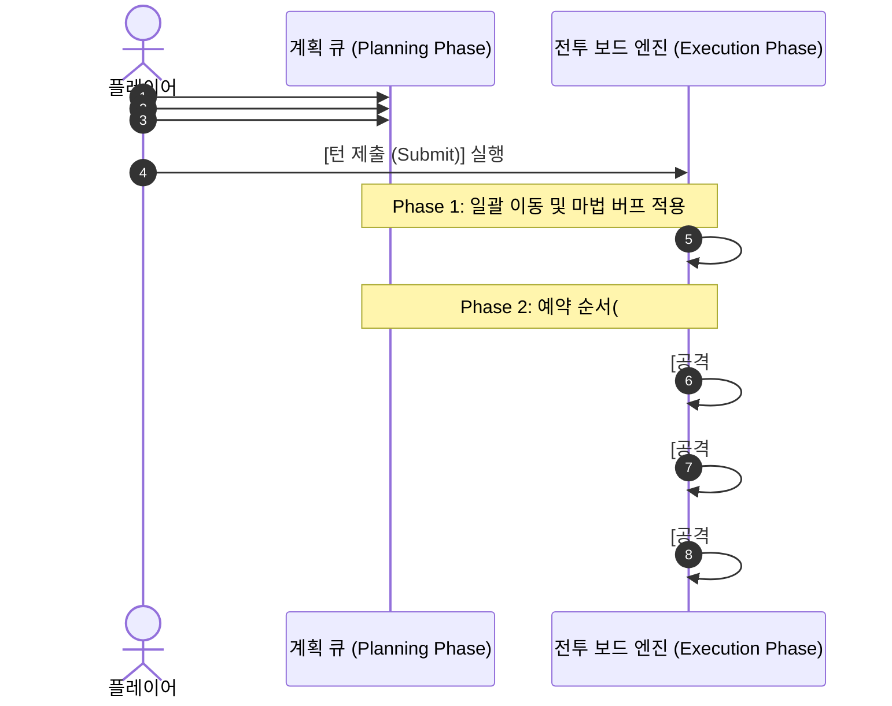

# [문서 1] 코어 전투 시스템 & 룰 기획서 (Core Combat & Rules GDD)

- **프로젝트 가칭**: Project CHESS CRACK (체스 크랙)
- **문서 역할**: 전투 엔진 로직, 기물 스탯/행마/사거리 판정, 턴 시퀀스, 요충지 시스템 명세
- **타겟 플랫폼**: Android 모바일 (가로 모드 Landscape 우선 출시) ➔ Steam (PC 와이드 확장)

---

## 1. 게임 핵심 정의 및 절대 규칙 (Core Pillars & Golden Rules)

### 1.1 핵심 엘리베이터 피치
정통 체스의 행마법을 기반으로 하되, **행동력(AP) 내 다중 기물 이동과 마법 카드를 함께 설계해 제출하면 일괄 이동 후 지정 순서대로 순차 공격이 발동**되는 퍼즐 택틱스 엔진 위에 **고딕 도트 + 스팀펑크 감성**과 **로그라이크 시너지 진화**를 결합한 싱글플레이 전략 RPG.

### 1.2 3대 절대 불변 규칙 (Engine Invariants)
1. **왕의 죽음 = 패배 (King Death = Defeat)**
   - 모든 스테이지(일반전, 비대칭 엘리트전, 보스전)를 관통하는 절대 규칙이다.
   - 적 군단의 남은 기물이 아무리 많아도 **적의 킹(King) HP를 0으로 만들면 즉시 승리**하며, 아군 킹의 HP가 0이 되면 즉시 패배한다.
2. **단일 시퀀스 일관성 (`계획 제출 ➔ 일괄 이동/마법 부여 ➔ 순차 공격`)**
   - 기물의 이동과 액티브 마법 카드 사용은 모두 **계획(Planning) 페이즈**에서 예약하여 한 번에 **제출(Submit)**한다.
   - 어떤 마법 카드도 이 근간 룰을 깨고 계획 단계에서 즉시 공격을 발동하지 않는다. 제출 후 반드시 **[Phase 1: 모든 예약 기물 일괄 이동 및 마법 적용] ➔ [Phase 2: 이동 예약 순서(#1 ➔ #2 ➔ #3)대로 순차 자동 공격]** 순서로만 작동한다.
3. **이동한 기물만 공격 (Move-to-Attack)**
   - 이번 턴에 이동(또는 위치 교환/승급 마법 적용)을 수행한 기물만 착지 후 공격을 발동한다. 제자리에 대기한 기물은 공격하지 않는다.

---

## 2. 기물 스탯 체계 및 행동력(AP) 규칙

### 2.1 행동력(AP) 및 조작 제한
- **기본 제공 AP**: 턴당 기본 **5 AP** (패시브 증강, 요충지 점령 보상에 따라 확장 가능).
- **기물당 이동 횟수 제한**: 한 기물은 기본적으로 **1턴에 1회만 이동 가능**하다 (단, 특수 마법 카드나 패시브 진화 효과를 받은 경우 예외).
- **SRPG식 교전(비겹침 타격)**: 정통 체스처럼 적 기물이 있는 칸으로 직접 겹쳐서 잡지 않는다. **빈 타일로 이동하여 착지한 뒤, 착지 지점 기준 공격 범위 내에 있는 적들에게 데미지를 입혀 HP를 0으로 만들면 파괴(소멸)**시킨다.
- **피해량 공식**:
  $$\text{최종 피해량} = \max\left(1, \lfloor \text{공격자 ATK} \times \text{시너지 배율} \rfloor - \text{피격자 유효 DEF}\right)$$

### 2.2 기물 6종 기본 스탯 및 이동/공격 사거리 명세

| 기물 클래스 | 이동 AP | 기본 HP | 기본 ATK | 기본 DEF | 이동 규칙 (체스 원형) | 착지 후 자동 공격 범위 (다음 수 행마 기준) | 스코어 가중치 | 대장간 1강당 상승치 |
| :--- | :---: | :---: | :---: | :---: | :--- | :--- | :---: | :--- |
| **폰 (Pawn)** | **1** | 25 | 10 | 2 | 전방 1칸 (첫 이동 2칸, 좌우 1칸 전술보행) | **예외 규칙**: 착지 칸 기준 **상하좌우(4방향) 1칸** 동시 타격 | 10점 | HP +8, ATK +3, DEF +1 |
| **나이트 (Knight)** | **2** | 45 | 16 | 3 | L자 도약 (경로상 장애물 무시) | 착지 칸 기준 **L자 8개 지점** 동시 타격 | 25점 | HP +12, ATK +5, DEF +1 |
| **비숍 (Bishop)** | **2** | 35 | 18 | 1 | 대각선 무제한 이동 | 착지 칸 기준 **4대각선 방향 첫 충돌 적** 타격 | 25점 | HP +10, ATK +6, DEF +1 |
| **룩 (Rook)** | **3** | 70 | 22 | 5 | 십자(직선) 무제한 이동 | 착지 칸 기준 **4직선(십자) 방향 첫 충돌 적** 타격 | 40점 | HP +20, ATK +7, DEF +2 |
| **퀸 (Queen)** | **4** | 65 | 28 | 4 | 8방향(십자+대각) 무제한 이동 | 착지 칸 기준 **8방향 첫 충돌 적** 전부 타격 | 60점 | HP +18, ATK +9, DEF +2 |
| **킹 (King)** | **1** | 100 | 15 | 4 | 주변 8방향 1칸 이동 | 착지 칸 기준 **주변 8칸(3×3 외곽)** 전체 타격 | *(별도)* | HP +25, ATK +4, DEF +2 |

### 2.3 사선 막힘 (Line-of-Sight Blocking) 판정
- **비숍, 룩, 퀸**의 직선/대각선 공격은 각 방향 줄기마다 **가장 먼저 마주치는 기물(아군·적군 무관)에서 멈춘다.**
  - 경로 앞에 **아군 기물**이 서 있으면 사선이 막혀 그 너머의 적을 타격할 수 없다.
  - 경로 앞의 **첫 번째 적**을 타격하면, 그 뒤에 서 있는 두 번째 적은 타격받지 않는다 (단, '관통 마법탄' 카드나 '프리즘 레이저' 만렙 진화 보유 시 관통).
- **나이트**의 L자 공격은 장애물 영향을 받지 않고 착지 지점 기준 8개 L자 포인트에 있는 모든 적을 동시 타격한다.

---

## 3. 턴 진행 시퀀스 및 연쇄 전술 메커니즘

### 3.1 핵심 전술 콤보 2가지
1. **아군 길 터주기 (Self-Unblocking)**:
   - 모든 기물의 이동이 먼저 완료(Phase 1)된 후 공격(Phase 2)이 시작되므로, 내 룩이나 비숍 앞을 가로막던 아군 기물을 옆으로 치우는 이동과 장거리 기물의 이동을 한 턴에 함께 제출하면 깔끔하게 사선이 열린다.
2. **전열 철거 후 후열 관통 (Sequential Breach)**:
   - 공격은 플레이어가 기물을 예약한 순서(`#1` ➔ `#2` ➔ `#3`)대로 순차 발동한다.
   - `#1` 기물의 공격으로 적 앞줄 기물이 파괴되어 즉시 타일이 비워지면, 뒤이어 발동하는 `#2` 비숍/룩/퀸의 공격 사선이 뚫리면서 적 본진 깊숙이 숨어 있던 적 킹을 타격할 수 있다.

---

## 4. 전략적 요충지 (Dynamic Stronghold) 시스템

수비적인 체스 교착 상태를 깨고 공방의 긴장감을 불어넣기 위해 보드 위에 주기적으로 생성되는 전술 거점이다.

### 4.1 생성 규칙 및 전황 스코어($S$) 공식
- **등장 빈도 제한**: 한 스테이지(1판)당 **최대 2~3회만** 등장한다 (기본 **3턴, 6턴, 9턴** 시작 시점).
- **전황 스코어($S$) 계산**:
  $$S = \sum \left(\text{생존 기물 가중치} \times \frac{\text{현재 HP}}{\text{최대 HP}}\right) + \left(\frac{\text{킹 현재 HP}}{\text{킹 최대 HP}} \times 100\right)$$
- **생성 위치**:
  - 스코어가 **불리한 진영(열세 진영)의 전열로부터 1~2칸 이내의 안전한 빈 타일**에 생성된다.
  - 플레이어가 불리할 때는 내 진영 근처에 생겨 지키기 수월하고, 반대로 플레이어가 유리할 때는 **적 진영 근처에 생성**되므로 적이 점령하기 전에 진격해서 방해하거나 빼앗아야 한다.

### 4.2 점령 조건 (2턴 유지) 및 엄폐 보너스
- **엄폐 버프**: 요충지 타일 위에 올라선 기물은 즉시 **받는 피해량 -30% 감소** 효과를 받아 적의 견제에 쉽게 죽지 않는다.
- **2턴 유지 점령**: 요충지 타일 위에 기물을 올린 상태로 **2턴 동안 생존 유지**하면 점령이 완료되며, 즉시 요충지가 소멸하면서 아래의 열세 비례 차등 보상이 발동한다.

### 4.3 열세 정도(Tier 1~3)에 따른 차등 보상 테이블

| 열세 단계 | 전황 스코어 열세율 기준 | 요충지 2턴 점령 완료 시 발동 보상 | 밸런스 설계 의도 |
| :--- | :--- | :--- | :--- |
| **Tier 1 (백중세 / 경미한 열세)** | 열세율 **0% ~ 15%** | • 다음 턴 가용 **AP +1** • 점령 기물 **최대 HP의 30% 회복** | 과도한 밸런스 붕괴 없이 기물 1기를 추가 기동하거나 전열을 유지하는 전술적 이득 제공 |
| **Tier 2 (중간 열세)** | 열세율 **15% ~ 35%** | • 다음 턴 가용 **AP +2** • 아군 전체 기물 **2턴간 ATK +20%, DEF +2** | 밀리는 전선을 재건하고 중코스트 기물(나이트/비숍/룩)을 추가 투입해 반격 콤보 유도 |
| **Tier 3 (심각한 위기)** | 열세율 **35% 이상** 또는 **킹 HP 30% 이하** | • 다음 턴 가용 **AP +2** • 아군 킹 **보호막 +30 부여** • **[긴급 전술 마법 카드 1장]** 즉시 지급 | 일방적인 패배를 막고 적 킹 역암살이나 전황 뒤집기를 노릴 한 방의 기회 제공 |
