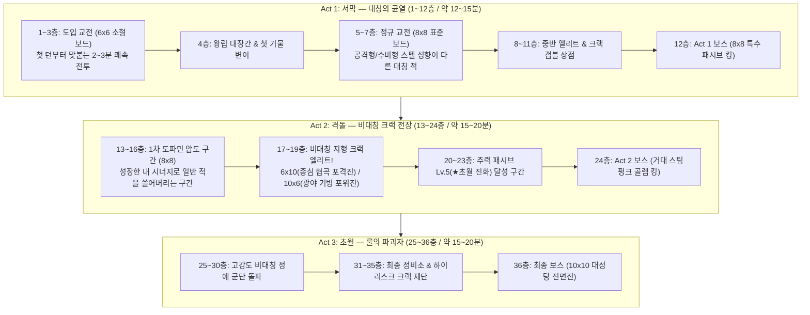

# [문서 2] 등반 구조·시너지·마법 카드 & 크랙(Crack) 기획서

- **프로젝트 가칭**: Project CHESS CRACK (체스 크랙)
- **문서 역할**: 36층 로그라이크 등반 설계, 가변 보드 기믹, 보상 경제 밸런스, 패시브/액티브/크랙 데이터 명세

---

## 1. 스테이지 등반(Climb) 구조 및 가변 보드 설계

### 1.1 레퍼런스 사례 연구 기반 골든 포뮬러
*Slay the Spire*, *Monster Train*, *Balatro*, *Inscryption*, *Into the Breach* 5대 등반형 로그라이크 분석을 통해 도출한 호흡 설계입니다.
- **단일 스테이지(전투 1판) 호흡**: 초반 **2~3분**, 중후반 **4~6분** (언제든 앱 종료 시 현재 층/턴 자동 세이브 및 이어하기 지원).
- **전체 등반(1 Run 완주) 호흡**: **45~60분** (총 **3개 Act × 12층 = 36계단**).
- **노드 비율**: 체스 수읽기의 피로도를 제어하기 위해 실제 전투는 **16~18회**로 맞추고, 전투 사이에 **정비소(대장간/기물 변이), 상점, 크랙 갬블 제단, 랜덤 이벤트** 노드를 교차 배치한다.
- **기물 손실 스트레스 ZERO**: 전투 중 파괴된 아군 기물은 스테이지 클리어 시 **100% 자동 부활**한다.

### 1.2 3-Act 등반 흐름 및 가변 보드(Dynamic Board Geometry)

---

## 2. 보상 경제 및 '선택과 집중' 밸런싱 모델

### 2.1 핵심 철학: "전 슬롯 만렙 배제 ➔ 매 판 다른 1~2개 코어 시너지 완성"
- 3지선다 보상에서는 *뱀파이어 서바이버즈*처럼 **내가 원하는 강화 카드가 매번 뜨지 않을 수 있다.**
- 끝까지 갔을 때 모든 6슬롯이 무조건 Lv.5 풀강화되어 획일화되는 것을 막고, **이번 등반에서 잘 붙는 1~2개의 핵심 컨셉에 투자를 집중해 매 판 전혀 다른 시너지 덱으로 클리어**하도록 보상 총량을 설계한다.

| 획득 경로 (36층 완주 기준) | 패시브 증강 선택 기회 | 액티브 마법 / 기물 개조 기회 | 밸런스 역할 |
| :--- | :---: | :---: | :--- |
| **일반 전투 클리어 (12~13회)** | **12~13회** (3지선다) | 골드 드랍 (상점/정비용) | 기본 성장. 원하는 카드가 안 뜨면 보조 시너지나 새 빌드 개척 유도 |
| **비대칭 엘리트 & 보스 (4~5회)** | **4~5회** (고등급 가중치) | **액티브 카드 4~5회** 확정 드랍 | 강적 돌파 시 패시브 레벨업과 액티브 스펠을 동시에 획득 |
| **상점 / 이벤트 / 갬블 노드 (8~10회)** | **3~4회** (타겟 구매/갬블) | **기물 강화/변이 5~6회** + 액티브 2~3회 | 골드 리롤 및 확정 구매로 주력 패시브의 Lv.5(★진화) 달성을 뒷받침 |
| **1회 등반 총합 (Total)** | **총 19 ~ 22회 패시브 선택** | **액티브 6~8회 / 기물 개조 5~6회** | 6슬롯 풀만렙(30레벨) 불가능! **평균 완성 덱: `[Lv.5 ★주력] + [Lv.5 ★부주력] + [Lv.3] + [Lv.2] + [Lv.2] + [Lv.1]`** |

### 2.2 저점 보장(Floor) vs 초고점 폭발(Ceiling) 3중 안전장치
1. **저점 보장 (확정 스탯 연마)**: 패시브/갬블 운이 나쁜 판이라도 정비소 대장간에서 전 기물 기본 스탯(HP/ATK/DEF)을 확정 강화할 수 있어, 수읽기와 요충지 활용만으로 클리어 가능한 저점을 보장한다.
2. **실패 보정 (크랙 천장 게이지)**: 정비소 갬블에서 대박이 안 떠도 '크랙 게이지'가 누적되어, 게이지 100% 도달 시 다음 선택에서 원하는 패시브 레벨업이나 기물 변이를 확정 제공한다.
3. **초고점 폭발**: 몇 판에 한 번, 3지선다와 갬블 운이 한쪽으로 쏠려 **Lv.5(★초월 진화)가 3개 이상** 터지거나 **크랙 합체 기물**이 탄생하면 화면 전체를 지워버리는 극한의 도파민을 경험한다.

---

## 3. 패시브 증강 (6슬롯) 및 ★만렙 초월 진화 테이블

- **슬롯 규칙**: 최대 **6칸**. 6칸이 꽉 찬 상태에서 신규 패시브를 영입하려면 **기존 6개 중 1개를 반드시 버리면서(폐기) 교체**해야 한다.
- **성장 규칙**: 동일 패시브 중복 선택 시 `Lv.1 ➔ Lv.5`까지 성장하며, **Lv.5 도달 시 즉시 체스 룰을 비트는 '★초월 진화' 효과가 해금**된다.

| ID | 패시브 명칭 | 대상 | Lv.1 ➔ Lv.5 기본 성장 효과 | ★ Lv.5 초월 진화 (Overpower / Crack 효과) |
| :--- | :--- | :---: | :--- | :--- |
| **P01** | **기병대 돌격 교리** | 나이트 | 나이트 착지 공격력 **+15% ➔ +75%** | **★ 천둥기병 (Thunder Cavalry)**: 나이트가 착지 공격 시 8개 L자 타격 지점마다 상하좌우 1칸 십자 스플래시 번개 피해 추가 발사 |
| **P02** | **사선 정밀 조준** | 비숍 | 비숍 착지 공격력 **+20% ➔ +100%** | **★ 프리즘 레이저 (Prism Laser)**: 비숍의 대각선 공격이 첫 적에서 멈추지 않고 대각선 끝까지 모든 적을 완전 관통 |
| **P03** | **증기 기관 장갑** | 룩 | 룩 DEF **+2 ➔ +10**, 이동 시 최대 HP **8% ➔ 40% 보호막** | **★ 강철 폭주 기관차 (Juggernaut)**: 룩이 이동 시 아군 기물을 뛰어넘을 수 있으며(아군 길막 무시), 착지 공격력 1.5배 증폭 |
| **P04** | **보병 인해전술** | 폰 | 폰 최대 HP **+10 ➔ +50**, ATK **+4 ➔ +20** | **★ 끝없는 태엽 행군 (Zero-Cost Pawn)**: 모든 폰의 이동 AP 코스트가 **0 AP**가 되며(턴당 1회 이동 제한은 유지), 착지 시 주변 8칸 전체 타격 |
| **P05** | **연쇄 지휘 체계** | 전체 | 순차 공격 **#2 이후 기물**의 피해량 **+15% ➔ +75%** | **★ 그랜드 피날레 (Grand Finale)**: 한 턴에 2기 이상 이동 제출 시, **가장 마지막 순번으로 공격하는 기물의 공격이 2회 연속 발동** |
| **P06** | **마공학 축전기** | 시스템 | 홀수 레벨마다 최대 AP **+1**, 전체 ATK **+5% ➔ +25%** | **★ 과부하 원자로 (Overload Core)**: 매 턴 기본 가용 AP **+2** 추가 및 모든 아군 기물의 공격이 적 DEF를 5 무시 |
| **P07** | **피의 진군** | 전체 | 적 기물 처치 시 아군 전체 HP **+5 ➔ +25 회복** | **★ 학살자의 대관식 (Chain Promotion)**: 아군 일반 기물(폰/나이트/비숍)이 적을 처치하면 즉시 상위 등급 기물(나이트/룩/퀸)로 전장 승급 |
| **P08** | **근위대 결속** | 전체/킹 | 아군 전체 DEF **+1 ➔ +5**, 킹 주변 아군 피해 감소 | **★ 성채 타워링 (Castle Stack)**: 매 턴 시작 시 전군 보호막 +15 부여 & 아군 기물 2기를 한 칸에 겹쳐 배치하는 타워링(중첩) 해금 |
| **P09** | **전술적 사선 개척** | 전체 | 아군 이동으로 다른 아군의 사선을 열어주면 ATK **+15% ➔ +75%** | **★ 합동 십자포화 (Crossfire)**: 한 턴에 두 개 이상의 아군 기물에게 동시에 타격받은 적은 받는 피해량 2배 증폭 |
| **P10** | **공간 왜곡 기어** | 시스템 | 보드 테두리(외곽) 칸에 착지한 기물 ATK **+20% ➔ +100%** | **★ 뫼비우스 보드 (Pac-Man Warp)**: 보드 좌우 끝 열이 연결되어 비숍/룩/퀸의 공격 사선이 벽을 통과해 반대편 끝에서 튀어나옴 |

---

## 4. 액티브 마법 카드 (4슬롯: 지속형 vs 1회 소멸형)

- **코어 룰 준수**: 모든 액티브 카드는 **계획(Planning) 단계에서 기물 이동과 함께 예약·제출(Submit)**하며, 일괄 이동 및 순차 공격 타임라인 안에서만 작동한다.
- **슬롯 강제 교체**: 액티브 슬롯은 최대 **4칸**이며, 4칸이 가득 찬 상태에서 새 액티브 카드를 획득하면 **기존 4장 중 1장을 무조건 버리고 교체**해야 한다.

### 4.1 라운드 지속형 액티브 카드 (Reusable — 다음 스테이지에서도 계속 사용 가능)

| ID | 카드명 | 분류 | 쿨타임 / 제한 | 계획(Planning) 단계 예약 및 실행 효과 |
| :--- | :--- | :--- | :---: | :--- |
| **A01** | **전술 기동 지시** | Additional Action | 라운드당 1회 | 이동 예약한 아군 기물 1개의 이번 턴 이동 AP 코스트를 **-1** 감소시킨다. |
| **A02** | **캐슬링 스왑** | Special Move | 3턴 쿨타임 (1 AP) | 같은 행/열의 아군 기물 2개 위치를 서로 맞바꾸도록 예약한다. 제출 시 두 기물 모두 이동 판정을 받아 순차 공격을 수행한다. |
| **A03** | **관통 마법탄 장전** | Special Attack | 라운드당 1회 | 이동 예약한 비숍/룩/퀸 1기에 부여한다. 순차 공격 시 첫 번째 적을 뚫고 **경로상 두 번째 적까지 관통 타격**한다. |
| **A04** | **증기 충격파 착지** | Special Attack | 3턴 쿨타임 | 이동 예약한 기물 1기에 부여한다. 순차 공격 시 피격된 적들을 타격 방향 뒤로 1칸 밀쳐낸다(넉백). |
| **A05** | **기어 폼 시프트** | Form Change | 라운드당 1회 | 아군 나이트 1기와 비숍 1기의 행마법 및 공격 범위를 이번 턴 동안 서로 맞바꾼다. |
| **A06** | **강철 바리케이드** | Tactical Buff | 2턴 쿨타임 | 지정한 아군 기물 1기에게 제출 즉시 **보호막 +25**를 부여한다. |

### 4.2 1회 소멸형 액티브 카드 (Consumable — 1회 사용 시 즉시 소멸, 미사용 시 다음 라운드 이월)

| ID | 카드명 | 분류 | 소모 규칙 | 계획(Planning) 단계 예약 및 실행 효과 |
| :--- | :--- | :--- | :---: | :--- |
| **C01** | **질풍의 2단 박차** | Additional Action | **1회 사용 시 소멸** | 이동 예약한 아군 기물 1기가 순차 공격 페이즈에 **착지 공격을 2회 연속 발사**한다. |
| **C02** | **차원 도약문** | Special Move | **1회 사용 시 소멸** | 지정한 아군 기물 1개가 이번 턴 경로상 장애물을 무시하고 중립/아군 지역의 원하는 빈칸으로 도약 이동하도록 예약한다. |
| **C03** | **과충전 연쇄 뇌격** | Special Attack | **1회 사용 시 소멸** | 이동 예약한 기물 1기의 이번 턴 **공격력을 1.8배**로 증폭시키고, 피격된 적 상하좌우 인접 적에게 50% 연쇄 번개 피해를 입힌다. |
| **C04** | **비상의 대관식** | Form Change | **1회 사용 시 소멸** | 지정한 아군 **폰(Pawn) 1기**를 이번 스테이지 동안 **퀸(Queen)**으로 즉시 승급시킨다 (제출 시 퀸으로 변신하여 순차 공격 수행). |
| **C05** | **키메라 융합 (크랙)** | Form Change / Crack | **1회 사용 시 소멸** | 인접한 아군 기물 2개를 이번 스테이지 동안 **하나의 합체 기물로 중첩**시킨다 (HP 합산 + 두 기물 공격 범위 동시 발동). |
| **C06** | **처형자의 진격** | Move & Attack | **1회 사용 시 소멸** | 지정한 기물이 이번 턴 **HP 30% 이하인 적 일반 기물 칸으로 직접 겹쳐 이동**해 즉사시키고 그 자리에서 순차 공격을 이어간다. |

---

## 5. 크랙(Crack) 요소 및 진영 개조(Slot Mutation) 카탈로그

정통 체스에는 없는 '룰 변형 쾌감'을 주되, 기본 밸런스를 해치지 않도록 **정비소 크랙 제단(갬블)이나 만렙 진화 보상**으로 등장하는 특수 요소들입니다.

1. **진영 슬롯 변이 (Army Slot Mutation)**:
   - 내 체스판의 기본 `폰(Pawn)` 슬롯을 정비소에서 개조하여 **`자폭 태엽 폰(사망 시 주변 8칸 폭발)`**, **`방패병 폰(기본 보호막 보유)`**, 또는 **`추가 나이트/비숍`**으로 영구 교체.
2. **기물 타워링 (Stacking / 탑승)**:
   - 아군 기물 2개를 한 타일에 겹쳐 배치. 이동 시 상위 기물 행마로 함께 움직이며, 착지 시 두 기물의 공격 패턴이 동시에 발사됨 (예: `룩 + 나이트` 중첩 시 십자 포격과 8방향 L자 타격 동시 발사).
3. **신화 이형 기물 합체 (Chimera Pieces)**:
   - 정비소 '크랙 제단'에서 두 기물을 제물로 바쳐 탄생하는 특수 기물:
     - **아치비숍 (Archbishop = 나이트 + 비숍)**: L자 도약과 대각선 이동/공격을 모두 보유.
     - **챈슬러 (Chancellor = 나이트 + 룩)**: L자 도약과 십자 직선 이동/포격을 모두 보유.
