# [문서 3] 아트 디렉션(2D 고딕 도트 + 스팀펑크) & 멀티플랫폼 UI/UX 명세서

- **프로젝트 가칭**: Project CHESS CRACK (체스 크랙)
- **문서 역할**: 비주얼 아트 스타일 가이드, 도트 그래픽 에셋 규격, 타격감/VFX 연출, 안드로이드(가로) & 스팀(PC) UI/UX 설계

---

## 1. 핵심 아트 디렉션 (Visual Identity)

> [!IMPORTANT]
> **비주얼 핵심 키워드**: **`2D 정석 체스판` + `고딕(Gothic) 다크 분위기` + `정교한 도트 그래픽(Pixel Art)` + `한 스푼의 스팀펑크(A Touch of Steampunk)`**
> 과도하게 복잡한 기계판으로 가독성을 해치지 않고, **누구나 한눈에 알아볼 수 있는 클래식 체스판과 정통 체스 기물 실루엣**을 도트 그래픽으로 구현하되, UI 프레임·AP 게이지·요충지 장치·마법 카드 연출에만 **황동(Brass) 기어와 진공관, 증기 피스톤 같은 스팀펑크 디테일을 양념처럼 가미**한다.

### 1.1 4대 시각 요소 비율 및 역할

| 시각 요소 | 비중 | 구체적 표현 방식 |
| :--- | :---: | :--- |
| **1. 정석 체스판 & 클래식 기물 실루엣** | **40%** | • 흑/백 타일의 명도 대비가 뚜렷한 2D 탑다운(약간의 쿼터뷰 입체 두께감 있는 3/4 뷰) 정석 체스 보드 • 폰, 나이트, 비숍, 룩, 퀸, 킹의 전통적인 머리 모양 실루엣을 엄격히 유지하여 0.1초 만에 기물 종류 식별 가능 |
| **2. 고딕(Gothic) 다크 톤앤매너** | **30%** | • 어두운 대성당 석재 바닥, 스테인드글라스 빛 번짐, 중후한 석판 질감의 다크 타일과 상아/대리석 질감의 라이트 타일 • 아군 기물은 **창백한 백은/청금석(Alabaster & Cobalt)** 톤, 적군 기물은 **칠흑/진홍빛 흑요석(Obsidian & Crimson)** 톤 |
| **3. 2D 도트 그래픽 (Pixel Art)** | **20%** | • 기물당 `32×48 px` 또는 `48×64 px` 규격의 선명하고 밀도 높은 도트 스프라이트 • 기물 숨쉬기(Idle), 집어들기(Lift), 착지 찍기(Slam), 피격 흔들림(Hit Flash), 파괴 파편(Shatter) 도트 애니메이션 |
| **4. 한 스푼의 스팀펑크 (Steampunk Accent)** | **10%** | • **AP 게이지**: 파란 마력 증기가 차오르는 **황동 진공관(Nixie Tube / Brass Vial)** 도트 UI • **전략적 요충지**: 타일 바닥의 석판이 열리며 황동 톱니바퀴와 증기 피스톤이 솟아오르는 기믹 연출 • **마법/크랙 진화**: 기물이 만렙(★진화) 달성 시 기물 받침대에 황동 태엽 링이 회전하거나 마공학 스파크가 튀는 절제된 포인트 |

### 1.2 메인 컬러 팔레트 (Color Palette)
- **체스 보드 라이트 타일**: `#D8CFC2` (고풍스러운 상아빛 석재)
- **체스 보드 다크 타일**: `#3A3542` (고딕 슬레이트 다크 스톤)
- **배경 및 UI 베이스 (Gothic Charcoal)**: `#16141C` ~ `#221F2B`
- **스팀펑크 황동 포인트 (Brass & Copper)**: `#C89B3C` / `#8C6239` (보더 프레임, 기어, 요충지, ★진화 마크)
- **아군 마력 / AP / 이동 하이라이트 (Aether Cyan)**: `#38BDF8`
- **적군 위협 / 착지 공격 사거리 (Blood Crimson)**: `#F43F5E`

---

## 2. 도트 에셋 규격 및 전투 연출 (VFX & Game Feel)

그레이박싱(HTML 프로토타입) 단계를 넘어 실제 게임의 손맛과 도파민을 결정짓는 연출 사양입니다.

### 2.1 기물 도트 스프라이트 시트 규격
- **해상도 기준**: 기본 뷰포트 `1920×1080` (내부 픽셀 캔버스 `640×360`의 3배 정수 스케일링 적용으로 도트가 깨지지 않는 칼같은 픽셀 유지).
- **기물별 필수 모션 (4프레임~6프레임 경량 구성)**:
  1. `Idle`: 미세한 상하 부유 또는 마력/증기 깜빡임
  2. `Selected / Hover`: 기물이 살짝 공중으로 들리며 바닥에 그림자 생성 + `#1`, `#2` 황동 번호표 부착
  3. `Land & Attack`: 목표 타일에 쿵! 찍으며 착지 충격파 도트 이펙트 발생
  4. `Death`: 체스 말이 석재/금속 파편으로 갈라지며 부서지는 연출

### 2.2 '일괄 이동 ➔ 순차 공격' 쾌감 극대화 연출 (Juice & Impact)
1. **계획(Planning) 단계 연출**:
   - 기물을 선택해 목표 칸에 올리면 **푸른색 태엽 궤적 화살표**가 그려지고, 착지 지점에서 뻗어나가는 공격 사거리가 **붉은색 도트 크로스헤어 타일**로 맥동한다.
   - 앞서 예약한 `#1` 기물이 비켜주기로 한 자리는 반투명 잔상으로 표시되며, 즉시 `#2` 기물의 사선이 뚫리는 것이 시각적으로 연결된다.
2. **턴 제출(Submit) 시퀀스 연출**:
   - **황동 레버 당기기**: 우측 하단의 `[턴 제출]` 버튼을 누르면 스팀펑크 레버가 철컥 내려가며 증기음(*치익-!*)과 함께 실행 페이즈 돌입.
   - **일괄 이동**: 예약된 모든 기물이 `0.25초` 동안 동시에 잔상을 남기며 목표 칸에 착지(*쿵!*).
   - **순차 공격 (`#1` ➔ `#2` ➔ `#3`)**:
     - `#1` 기물 머리 위의 번호표가 황금빛으로 번쩍이며 공격 이펙트 발사!
     - 피격 시 **0.06초 히트스톱(Hit-stop)** + **카메라 미세 흔들림(Screen Shake)** + 흰색 피격 점멸(White Flash) + 도트 데미지 숫자 팝업!
     - 만약 `#1` 공격으로 적 앞줄 기물이 파괴되면 파편이 튀며 타일이 비워지고, 곧바로 `#2` 룩/비숍의 **관통 레이저/대포알 도트 이펙트**가 빈 공간을 뚫고 적 킹에게 꽂히는 연출!

---

## 3. 안드로이드(가로 모드) & 스팀(PC) 통합 UI/UX 레이아웃

안드로이드 스마트폰을 **가로로 회전(Landscape, 16:9 ~ 20:9)**시켜 플레이하는 환경과 **Steam PC(16:9 모니터)** 환경을 **단일 3-Zone 와이드 레이아웃**으로 완벽히 통합합니다.

```mermaid
flowchart LR
    subgraph LeftZone["[좌측 존: 24% 폭] 전황 & 패시브 6슬롯"]
        LZ1["상단: 스테이지 층수 & 스코어 천칭 게이지<br/>(요충지 카운트다운 황동 시계)"]
        LZ2["중단: 패시브 증강 6슬롯 그리드 (2x3)<br/>Lv.1~5 게이지 및 ★황동 기어 진화 테두리"]
        LZ3["하단: 현재 선택 기물 도트 초상화 & 상세 스탯"]
    end

    subgraph CenterZone["[중앙 존: 52% 폭] 가변형 고딕 체스 전장"]
        CZ1["상단 바: 적 킹 HP 게이지 & 적 군단 특성 배지"]
        CZ2["메인 보드: 6x6 / 8x8 / 6x10 / 10x6 / 10x10<br/>고딕 석재 체스판 + 이동 화살표 + 사거리 프리뷰"]
        CZ3["하단 바: 아군 킹 HP 게이지 & 진공관 AP 파이프 (5/5)"]
    end

    subgraph RightZone["[우측 존: 24% 폭] 순차 타임라인 & 액티브 4슬롯"]
        RZ1["상단: 순차 공격 타임라인 큐<br/>[#1 폰] ➔ [#2 나이트] ➔ [#3 룩]"]
        RZ2["중단: 액티브 마법 카드 4슬롯<br/>(지속형 황동 카드 vs 1회 소멸형 양피지 카드)"]
        RZ3["하단: [초기화] 버튼 & [턴 제출] 스팀펑크 레버 버튼"]
    end

    LeftZone --- CenterZone --- RightZone
```

### 3.1 모바일 가로 화면(터치) & PC(마우스) 겸용 조작 UX 원칙
1. **투탭(Two-Tap) & 드래그 겸용 조작**:
   - 모바일 가로 화면에서 손가락으로 기물이 가려지지 않도록 **`[기물 터치 선택] ➔ [이동할 타일 터치 시 공격 사거리 미리보기(1탭) 또는 즉시 예약]`**과 **마우스 호버/드래그**를 모두 지원한다.
2. **우측 타임라인에서 개별 취소 지원**:
   - `#1`, `#2`, `#3` 순서로 예약했다가 `#2`만 수정하고 싶을 때, 우측 타임라인의 `[취소]` 버튼을 누르면 해당 기물의 AP만 즉시 환불된다.
3. **슬롯 포화 시 직관적인 폐기·교체(Swap) 연출**:
   - 패시브 6칸 또는 액티브 4칸이 꽉 찼을 때 새 보상을 고르면, 기존 슬롯이 붉은 테두리로 활성화되며 **"버릴 카드 1장을 선택해 교체하세요"** 오버레이가 떠서 오조작 없이 교체할 수 있다.
