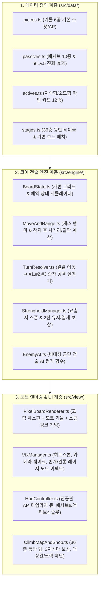

# [문서 4] AI 주도 기술 아키텍처 & 안드로이드/스팀 출시 로드맵

- **프로젝트 가칭**: Project CHESS CRACK (체스 크랙)
- **문서 역할**: AI 주도 개발 기술 스택, 코드 아키텍처, 도트 에셋 파이프라인, 안드로이드(Google Play) 및 스팀(Steam) 출시 마일스톤

---

## 1. 왜 '웹 게임 엔진 + 하이브리드 네이티브 패키징'인가?

게임을 처음 개발하는 입장에서 무거운 3D 엔진 에디터 사용법을 수개월간 독학하다 지치는 리스크를 없애고, **AI가 코드의 95% 이상(전투 엔진, 도트 렌더링, 셰이더/파티클 연출, 세이브 시스템, UI)을 직접 작성·수정하며 즉시 결과물을 확인할 수 있는 최적의 상용 파이프라인**입니다. (*Vampire Survivors*가 채택해 글로벌 히트를 기록한 검증된 방식입니다.)

### 1.1 확정 기술 스택 (Tech Stack)

| 계층 | 선택 기술 | 선정 이유 및 역할 |
| :--- | :--- | :--- |
| **코어 언어** | **TypeScript (Vite 번들러)** | 기물 스탯, 패시브 Lv.1~5 진화, 마법 카드 데이터의 타입 안정성 확보 및 AI 코드 자동 생성 최적화 |
| **2D 도트 & VFX 렌더러** | **Phaser 3** (또는 **PixiJS + Canvas**) | • 픽셀 아트(`pixelArt: true`, 안티앨리어싱 해제) 칼도트 렌더링 지원 • 스프라이트 시트 애니메이션, 카메라 쉐이크, 히트스톱, 도트 파티클(번개/레이저/증기) 내장 |
| **UI 레이아웃** | **HTML/CSS 오버레이 + Pixel Art UI Nine-Slice** | 3-Zone 와이드 레이아웃, 3지선다 보상 모달, 슬롯 폐기 교체 창을 모바일 가로 해상도(16:9~20:9)에 맞춰 반응형으로 칼같이 정렬 |
| **사운드 엔진** | **Howler.js / Web Audio API** | 체스 말 착지음, 스팀펑크 레버 증기음, 순차 공격 타격음(#1 ➔ #2 ➔ #3 피치 상승 효과) 제어 |
| **데이터 저장 (Save)** | **IndexedDB / LocalStorage JSON** | 36층 등반 중 언제든 앱을 껐다 켜도 현재 층·보유 패시브/액티브·전투 턴 상태 즉시 복원 |
| **Android 앱 패키징** | **Capacitor (Android Studio 연동)** | 웹 게임 빌드를 가로 고정(`screenOrientation: "landscape"`) 네이티브 안드로이드 앱(`.apk` / `.aab`)으로 즉시 변환 및 구글 플레이 출시 |
| **Steam PC 패키징** | **Electron** 또는 **Tauri** | 동일한 코드베이스를 Windows / macOS 실행 파일(`.exe`)로 패키징 및 Steamworks SDK(업적/클라우드 세이브) 연동 |

---

## 2. 게임 클라이언트 모듈 아키텍처 (Software Architecture)

AI와 협업할 때 기능 단위로 파일을 명확히 분리하여 유지보수와 밸런스 패치를 쉽게 만드는 구조입니다.

---

## 3. 단계별 개발 마일스톤 로드맵 (Production Roadmap)

### Phase 1: 코어 전투 엔진 고도화 & 그레이박싱 검증 *(현재 완료 단계)*
- [x] 가변 보드(`6×6`, `8×8`, `6×10`, `10×6`, `10×10`) 그리드 엔진 구축
- [x] `계획(이동 + 마법 예약) 제출 ➔ 일괄 이동 ➔ 이동 순서(#1➔#2➔#3) 순차 공격` 시퀀스 구현
- [x] 앞 기물 이동 예약 시 뒷 기물 사선이 실시간으로 열리는 가상 보드 프리뷰 구현
- [x] 요충지 판당 3회 생성, 엄폐 버프(-30%), **2턴 유지 점령**, 열세 Tier 1~3 차등 보상 구현
- [x] 패시브 6슬롯(Lv.5 ★진화) & 액티브 4슬롯(지속형/소모형 이원화 및 슬롯 포화 시 강제 폐기 교체) 구현

### Phase 2: '2D 고딕 도트 + 스팀펑크' 비주얼 & 타격감(Juice) 입히기 *(다음 착수 단계)*
- [ ] **고딕 체스판 & 스팀펑크 프레임 렌더러 적용**:
  - 투박한 HTML 표 대신 픽셀 아트 타일셋(고딕 석재 흑백 타일, 황동 기어 테두리, 증기 피스톤 요충지 타일) 적용
- [ ] **도트 기물 스프라이트 & 애니메이션 적용**:
  - 아군(백은/청금석) 및 적군(칠흑/진홍) 6종 체스 기물 도트 그래픽 및 Idle / Lift / Slam / Shatter 모션 구현
- [ ] **순차 공격 VFX & 사운드 이펙트**:
  - `#1 ➔ #2 ➔ #3` 순차 공격 시 히트스톱, 화면 흔들림, 대각선 프리즘 레이저, 나이트 연쇄 번개, 데미지 플로팅 텍스트 연출 추가

### Phase 3: 36층 등반 루프 & 정비소(대장간/기물 변이/크랙 갬블) 완성
- [ ] **3-Act × 12층(36계단) 등반 월드맵 UI**:
  - 고딕 대성당 탑을 기어 올라가는 스팀펑크 지도 화면 구현 (전투 노드 / 대장간 / 상점 / 크랙 제단 선택)
- [ ] **진영 개조(Slot Mutation) & 크랙 제단 시스템**:
  - 내 진영의 기본 폰을 특수 폰이나 상위 기물로 교체하고, 두 기물을 융합(아치비숍/챈슬러)하거나 중첩(타워링)시키는 시스템 완성
- [ ] **자동 세이브(Auto-Save) 및 이어하기**:
  - 모바일 환경에서 언제든 앱을 닫아도 현재 층과 덱 상태가 100% 유지되는 세이브 모듈 연동

### Phase 4: 안드로이드(Google Play) 우선 출시 & 스팀(Steam) 확장
- [ ] **안드로이드 가로 모드 패키징 (`Capacitor`)**:
  - 모바일 터치 영역 최적화, 가로 화면 고정(`Landscape`), 안드로이드 APK/AAB 빌드 생성 및 기기 테스트
- [ ] **스팀 PC 와이드 패키징 (`Electron / Tauri`)**:
  - 단축키(숫자키 1~4로 마법 카드 선택, Space로 턴 제출, R로 초기화), 해상도 옵션, Steam 빌드 배포
